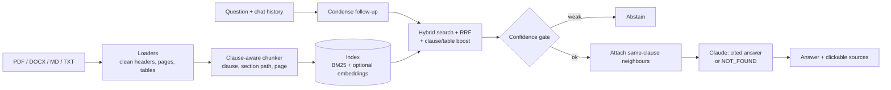

# CivilCode RAG

Citation-grounded question answering over your own civil engineering documents: design codes,
standards, specifications and course notes. Ask "What is the nominal cover for severe exposure?" and get
an answer that quotes the value, names the clause and table, and links to the exact passage.

## Problem statement → design

| Requirement | Design decision |
|---|---|
| Q&A over a **custom document set** | Drop PDF / DOCX / MD / TXT into `data/raw/` (or upload in the web UI) and run `ingest`. |
| Codes are organised by **clauses, tables, annexes** | Clause-aware chunker: one clause per chunk, tables never split mid-row, section path and clause number stored on every chunk. |
| Users ask by **clause number** ("what does 4.2 say") | Query parser detects `clause 4.2` / `Table 3`; matching chunks get a rank boost on top of hybrid search. |
| Questions use **exact terms** (M25, 40 mm, IS-style IDs) *and* paraphrases | Hybrid retrieval: BM25 (exact terms, always on) + dense embeddings (meaning, optional), fused with reciprocal-rank fusion. |
| **Wrong numbers are costly** | Answer prompt forces verbatim numbers/units, conditions stated with values, `[S#]` citation on every claim, and `NOT_FOUND` when sources are silent. Uncited answers are flagged. |
| Must **not hallucinate** outside the library | Pre-LLM confidence gate (refuses if no passage matches the question's terms), then LLM-level refusal. |
| **Follow-up questions** | Fast model rewrites "what about very severe?" into a standalone query. |
| Must be **measurable** | `civilrag eval`: doc/clause hit@k, MRR, context recall, abstention accuracy, answer correctness, optional Claude faithfulness judge. |
| Works **without an API key** | Retrieval and an extractive passage view run fully offline; Claude is only needed for written answers. |

## Architecture



```
src/civilrag/
  loaders.py    file -> clean text pages (PDF header/footer removal, DOCX tables -> markdown)
  chunking.py   clause-aware chunking
  index.py      BM25 + dense embeddings, persisted to store/
  retrieve.py   hybrid search, RRF, clause boost, optional cross-encoder rerank, confidence gate
  generate.py   Claude prompt, citation parsing, extractive fallback
  pipeline.py   ingest() and RAGEngine.ask()
  api.py        FastAPI: /api/ask, /api/upload, /api/docs  + web/index.html
  evaluate.py   metrics and report
config.yaml     every tunable setting
evals/qa_set.jsonl   gold questions (answerable and unanswerable)
tests/          chunker, retrieval, API, LLM-path (mocked)
```

## Quick start

```bash
python -m venv .venv && source .venv/bin/activate
pip install -r requirements.txt && pip install -e .
cp .env.example .env          # add ANTHROPIC_API_KEY for written answers (optional)

python -m civilrag ingest     # index data/raw (3 small sample docs included)
python -m civilrag ask "What is the nominal cover for severe exposure?"
python -m civilrag chat       # multi-turn
python -m civilrag serve      # web UI at http://127.0.0.1:8000
python -m civilrag eval       # retrieval + answer metrics -> evals/report.md
pytest -q
```

For semantic (dense) retrieval add `pip install sentence-transformers` and re-run `ingest`.
The first run downloads the embedding model from Hugging Face.

## Using your real documents

1. Put files in `data/raw/`. Use text-based PDFs; scanned PDFs need OCR first (`ocrmypdf in.pdf out.pdf`).
2. Run `ingest` and read the per-file chunk counts. A file with 1 giant chunk means no headings were
   detected: check that clause numbers sit on their own line (`4.2 Nominal cover`).
3. Write 20 to 50 questions of your own in `evals/qa_set.jsonl` (with the expected clause and a value that
   must appear), then run `eval`. Tune `config.yaml` against these, not against intuition.
4. Re-tune `min_coverage` (BM25-only) or `min_dense_sim` (hybrid) on your corpus.

> The sample `SCP-100` document is **fictional**: its numbers are invented for testing. The soil and structural
> notes are short generic summaries. Do not use any of them for design.

## Evaluation (sample corpus, BM25-only, retrieval-only mode)

| metric | value |
|---|---|
| doc hit@5 / clause hit@5 | 1.00 / 1.00 |
| MRR | 0.967 |
| context recall (expected value present in retrieved text) | 1.00 |
| unanswerable questions correctly refused | 3 / 3 |

Treat these as a smoke test only: the corpus is 28 chunks and the questions were written by the same
author as the documents. Expect lower numbers on real, longer, messier standards. The LLM-answer metrics
(`answer_correct`, `cited_rate`, `faithfulness`) only appear when `ANTHROPIC_API_KEY` is set and were
not run for this README.

## Known limitations

- **Tables in PDFs** often extract as flattened text; check critical tables. DOCX and Markdown tables are preserved.
- **Equations and symbols** in PDFs may lose formatting (superscripts, Greek letters).
- **Editions:** two editions of one code both get indexed. Name files with the edition (`IS456_2000.pdf`) so
  citations are distinguishable; per-edition filtering is a roadmap item.
- **No sign-off:** answers quote documents; they are not engineering judgement. Always verify against the official current code.
- Index rebuild is full, not incremental (fine for hundreds of documents, slow beyond that).

## Roadmap

1. Cross-encoder reranking (`retrieval.rerank: true`, already wired) and measuring its effect.
2. Edition/jurisdiction metadata filters (`doc_type`, `edition`, `year`).
3. Better PDF table extraction (pdfplumber/Docling) and OCR step in `ingest`.
4. Cross-reference following ("as per clause 4.2" pulls that clause into the context).
5. Qdrant/pgvector store for large libraries; incremental ingest keyed on file hash.
6. Streaming answers and per-user document collections.

## Credits

Structure and evaluation ideas (config-first pipeline, hybrid retrieval, hit@k/MRR/groundedness evals) follow the
[OpenAI knowledge-retrieval blueprint](https://github.com/openai/openai-knowledge-retrieval) that inspired this project.
This implementation is independent: Claude for generation, local BM25/embeddings, no OpenAI dependency, and
engineering-specific chunking, clause lookup and abstention.
